<div align="center">


<a href="https://github.com/AunMohammad254">
  
</a>

<br/>

[](https://github.com/AunMohammad254)
[](https://github.com/AunMohammad254?tab=followers)
[](https://github.com/AunMohammad254)
[](https://aunabbas-porfolio.vercel.app)

</div>

<br/>



```ts
const aun = {
  role: "Full-Stack Developer",
  edu: "BSCS Student",
  base: "Karachi, Pakistan 🇵🇰",
  stack: ["Next.js", "TypeScript", "MongoDB",
          "Supabase", "Tailwind CSS"],
  building: ["Blood Match 🩸", "HireFlow 💼"],
  exploring: ["Three.js + GSAP", "AI dev workflows"],
  funFact: "every AI-written PR gets audited 🕵️",
};
```

- ⚡ BSCS student who ships real products alongside coursework, not just tutorials
- 🩸 Building **Blood Match**, an emergency blood-donor matching platform for the MAJU CodeCraft hackathon
- 🧊 Turning **HireFlow** into an immersive 3D experience with Three.js, GSAP and Lenis
- 🤖 Curating reusable, phase-gated prompt systems for Claude Code and Gemini CLI
- 🏏 Cricket fan who turned that passion into a live quiz platform, **1Think2Win**
- 💬 Ask me about full-stack architecture, Next.js + MongoDB, or AI-assisted workflows

<br clear="right"/>


<p align="center">
  <a href="https://github.com/AunMohammad254/blood-match">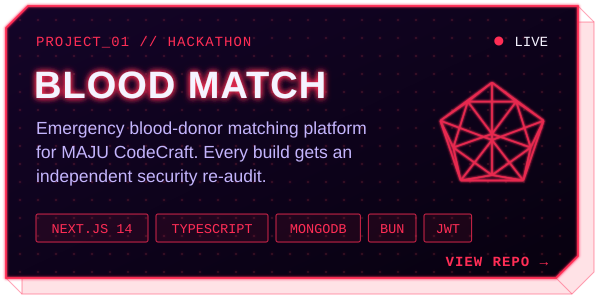</a>
  <a href="https://github.com/AunMohammad254?tab=repositories">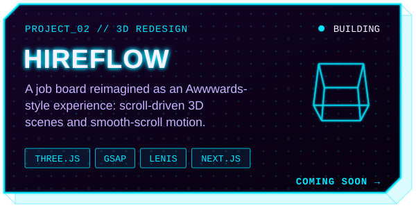</a>
</p>
<p align="center">
  <sub><b>BLOOD MATCH</b> → <a href="https://blood-match.vercel.app">live demo</a> · <a href="https://github.com/AunMohammad254/blood-match">source</a> &nbsp;&nbsp;│&nbsp;&nbsp; <b>HIREFLOW</b> → in development</sub>
</p>

<p align="center">
  <a href="https://github.com/AunMohammad254/1think2winsx">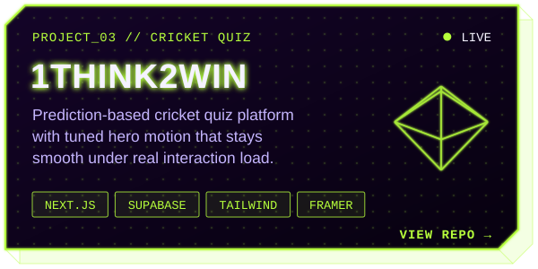</a>
  <a href="https://github.com/AunMohammad254/anime-legends">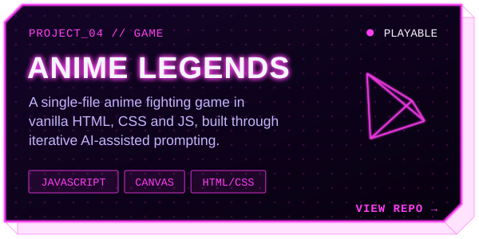</a>
</p>
<p align="center">
  <sub><b>1THINK2WIN</b> → <a href="https://1think2win.com/">live site</a> · <a href="https://github.com/AunMohammad254/1think2winsx">source</a> &nbsp;&nbsp;│&nbsp;&nbsp; <b>ANIME LEGENDS</b> → <a href="https://anime-legends-by-aun-abbas.netlify.app/">play it</a> · <a href="https://github.com/AunMohammad254/anime-legends">source</a></sub>
</p>


<div align="center">

<code>// languages</code><br/>


<code>// frontend + 3d motion</code><br/>


<code>// backend + data</code><br/>


<code>// tools + workflow</code><br/>


</div>

<br/>


<div align="center">


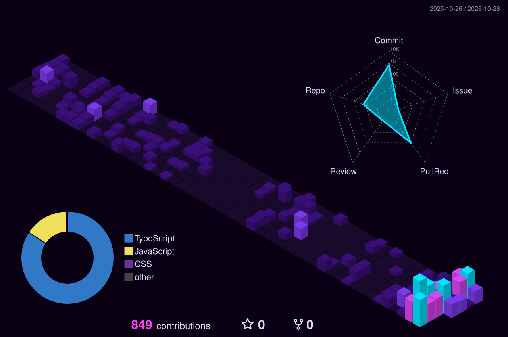

</div>


<div align="center">

[](https://linkedin.com/in/aun-abbas-847234254)
[](mailto:aunmohammad254@gmail.com)
[](https://aunabbas-porfolio.vercel.app)
[](https://instagram.com/aunmohamad)
[](https://www.facebook.com/profile.php?id=100009448583945)

<br/>


</div>

